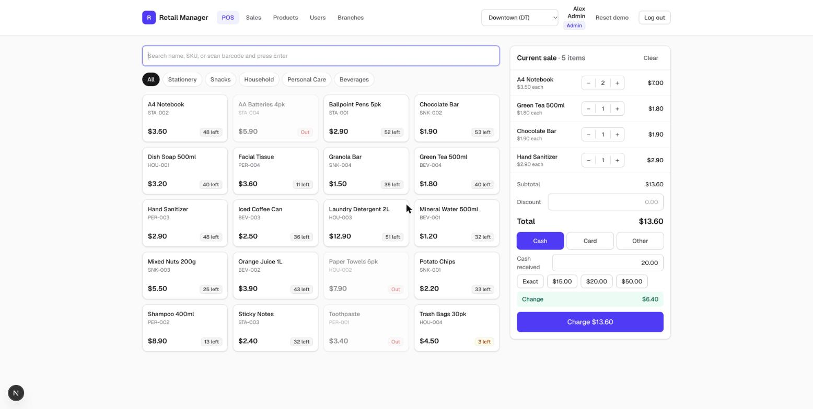
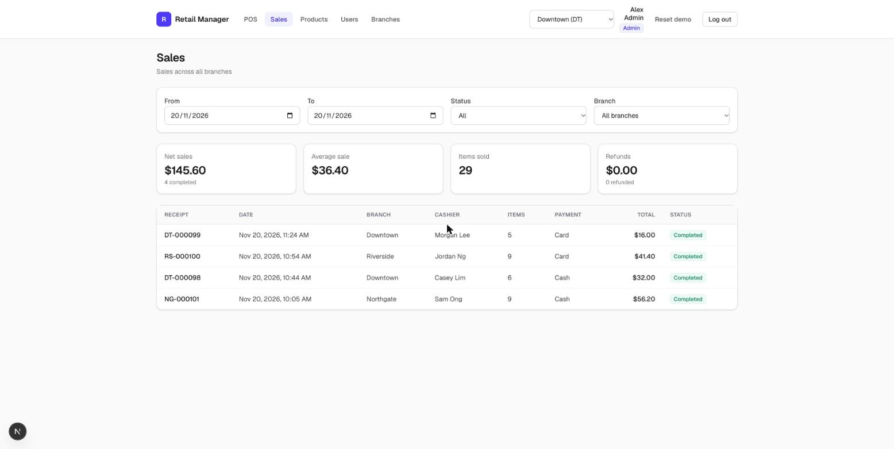

# Retail Manager

An open-source **point of sale and sales management system for multi-branch retail stores**.
Cashiers ring up sales, managers handle refunds and stock, and admins manage branches and staff, each seeing only what their role allows.

Built as a TypeScript monorepo: **Next.js 16** web app, **Hono** API, **Drizzle ORM** + **PostgreSQL**.





> **Project status:** the web app is complete and runs on built-in demo data stored in your browser. The REST API (auth, branches, products, stock, sales, refunds, users) is complete and tested. Connecting the web app to the API is the next milestone. See [`todo.md`](todo.md) for the roadmap.

## Features

- **POS checkout:** search by name or SKU, or scan a barcode and press Enter; cart with quantity limits based on branch stock; discounts; cash (with change calculation and quick-cash buttons), card or other payment; printable receipts.
- **Sales:** filter by date, status and branch; totals for net sales, average sale, items sold and refunds; receipt detail page; refunds with a reason, which put the items back in stock.
- **Multiple branches:** each branch has its own stock and sales; admins switch between branches.
- **Staff roles:**

  | | Admin | Manager | Cashier |
  | --- | :---: | :---: | :---: |
  | Sell (POS) | ✓ all branches | ✓ own branch | ✓ own branch |
  | View sales | ✓ all branches | ✓ own branch | ✓ own branch |
  | Refund sales | ✓ | ✓ | |
  | Set stock | ✓ | ✓ own branch | |
  | Add / edit products | ✓ | | |
  | Manage users & branches | ✓ | | |

- **Safe by design (API):** hashed passwords (scrypt), httpOnly session cookies, every rule checked on the server, sales and stock updates in database transactions, and no overselling even when two tills sell the last item at the same time.

## Tech stack

| Part | Technology |
| --- | --- |
| Web | Next.js 16 (App Router), React 19, Tailwind CSS v4 |
| API | Hono on Node.js, zod validation |
| Database | PostgreSQL 17 (Docker), Drizzle ORM + drizzle-kit migrations |
| Monorepo | pnpm workspaces, Turborepo |
| Code quality | TypeScript (strict), ESLint, [Fallow](https://fallow.tools) |

## Getting started

### Prerequisites

- **Node.js 22.9 or newer**: `node -v`
- **pnpm 10**: run `corepack enable` once and Node will use the pnpm version pinned in `package.json`
- **Docker** (Docker Desktop or Docker Engine with Compose): only needed for the database and API

### 1. Get the code

Clone it, or click **Use this template** / **Fork** on GitHub to start your own copy:

```bash
git clone https://github.com/ken88ling/elid-website.git
cd elid-website
pnpm install
```

### 2. Quick start: try the web app (no database needed)

```bash
cp apps/web/.env.example apps/web/.env.local
pnpm --filter @app/web dev
```

Open <http://localhost:3000> and sign in with a demo account (also listed on the login page):

| Role | Email | Password |
| --- | --- | --- |
| Admin (all branches) | `admin@demo.store` | `admin123` |
| Manager, Downtown | `manager.dt@demo.store` | `manager123` |
| Cashier, Downtown | `cashier.dt@demo.store` | `cashier123` |
| Cashier, Riverside | `cashier.rs@demo.store` | `cashier123` |

Demo data lives in your browser's local storage. Admins can restore it with **Reset demo** in the header.

### 3. Full setup: database and API

```bash
# Environment files (the defaults work for local development)
cp apps/api/.env.example apps/api/.env
cp apps/web/.env.example apps/web/.env.local   # if you skipped step 2

# Start PostgreSQL in Docker (exposed on port 5433)
pnpm db:up

# Create the tables, then load the demo branches, users, products and sales
pnpm db:migrate
pnpm db:seed

# Run the web app (:3000) and the API (:4000) together
pnpm dev
```

Check that it works:

```bash
curl http://localhost:4000/health
# {"status":"ok"}

curl -i -X POST http://localhost:3000/api/auth/login \
  -H 'content-type: application/json' \
  -d '{"email":"admin@demo.store","password":"admin123"}'
# HTTP/1.1 200 OK, with a Set-Cookie: rbms_session=... header
```

The web app proxies `/api/*` to the API, so the browser talks to one origin and the session cookie just works.

**Stopping and resetting**

```bash
pnpm db:down            # stop PostgreSQL (data is kept in a Docker volume)
pnpm db:seed --reset    # wipe the database and load fresh demo data
```

### Troubleshooting

- **Port 3000, 4000 or 5433 already in use:** stop the other program, or change `PORT` in `apps/api/.env` (and `API_URL` in `apps/web/.env.local`), or the host port in `docker-compose.yml` (and `DATABASE_URL`).
- **`Cannot connect to the Docker daemon`:** start Docker Desktop, then run `pnpm db:up` again.
- **`pnpm db:seed` says the database already has data:** use `pnpm db:seed --reset` to wipe and reseed.

## Scripts

Run from the repository root.

| Command | What it does |
| --- | --- |
| `pnpm dev` | Web app and API in watch mode |
| `pnpm --filter @app/web dev` | Web app only |
| `pnpm --filter @app/api dev` | API only |
| `pnpm build` | Production build of every package |
| `pnpm lint` / `pnpm typecheck` | ESLint / TypeScript checks |
| `pnpm fallow` | Dead code, duplication and complexity report |
| `pnpm db:up` / `pnpm db:down` | Start / stop PostgreSQL in Docker |
| `pnpm db:generate` | Create a migration after changing `apps/api/src/db/schema.ts` |
| `pnpm db:migrate` | Apply migrations |
| `pnpm db:seed [--reset]` | Load demo data |
| `pnpm db:studio` | Browse the database in Drizzle Studio |

## Project structure

```
apps/
  web/            Next.js app: POS, sales, products, users and branches pages
    src/lib/data/ Data layer the pages call (browser demo data today, the API next)
  api/            Hono REST API
    src/routes/   auth, branches, products, sales, users
    src/db/       Drizzle schema, client and seed script
    drizzle/      SQL migrations
packages/
  shared/         Domain types and demo data used by both apps
docker-compose.yml  PostgreSQL for local development
todo.md           Roadmap and progress
```

## API overview

All endpoints are under `/api` and return JSON. Errors look like `{ "error": "message" }` with a matching HTTP status (400 validation, 401 not signed in, 403 not allowed, 404 not found, 409 conflict).

| Method & path | Who | Purpose |
| --- | --- | --- |
| `POST /auth/login`, `POST /auth/logout`, `GET /auth/me` | anyone | Session cookie sign-in |
| `GET /branches`, `POST /branches`, `PATCH /branches/:id` | list: all, write: admin | Branches |
| `GET /products?branchId=` | own branch (admin: any) | Products with branch stock |
| `POST /products`, `PATCH /products/:id` | admin | Catalog |
| `PUT /products/:id/stock` | admin, manager | Set branch stock |
| `POST /sales`, `GET /sales`, `GET /sales/:id` | own branch (admin: any) | Ring up and view sales |
| `POST /sales/:id/refund` | admin, manager | Refund and restock |
| `GET /users`, `POST /users`, `PATCH /users/:id` | admin | Staff accounts |

## Using it for your own store

- **Change the demo passwords.** The demo accounts are public. Create your own admin, then deactivate the demo users, or edit `packages/shared/src/seed.ts` before seeding.
- **Currency:** set `NEXT_PUBLIC_CURRENCY` in `apps/web/.env.local` (for example `SGD`, `EUR`, `GBP`).
- **Production:** set a strong Postgres password and `DATABASE_URL`, set `NODE_ENV=production` for the API so cookies are `Secure`, and serve everything over HTTPS. Set `API_URL` **before** building, because the web app's `/api` proxy is fixed at build time. Build with `pnpm build`, then run `node apps/api/dist/index.js` (from `apps/api`, with its `.env`) and `pnpm --filter @app/web start`.
- **Tax, inventory transfers, customers and reports** aren't built yet; they are listed under "Later" in [`todo.md`](todo.md).

## Contributing

Issues and pull requests are welcome. Before opening a PR:

```bash
pnpm lint && pnpm typecheck && pnpm build && pnpm fallow
```

Business rules currently exist in both the web demo data layer (`apps/web/src/lib/data`) and the API (`apps/api/src/routes`), so change them in both places until the web app is connected to the API.

## License

[MIT](LICENSE): free to use, copy, modify and distribute, including commercially.
